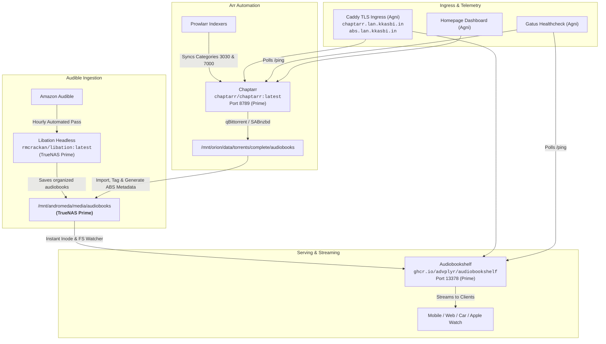

# 📚 KryNet Audiobook Ecosystem Architecture & Operational Runbook

This document details the complete end-to-end architecture, naming conventions, integration matrix, deduplication logic, and automation runbooks for the audiobook stack on KryNet: **Audiobookshelf**, **Chaptarr**, and **Libation Headless**.

---

## 🏛️ Ecosystem Architecture



---

## 📂 Standard Naming & Directory Format

To ensure seamless coexistence across **Audiobookshelf**, **Chaptarr**, and **Libation**, the canonical naming format conforms strictly to Audiobookshelf specifications:

### Directory Structure
```
/mnt/andromeda/media/audiobooks/
└── {Author}/
    ├── {Series}/
    │   └── {Series Order} - {Title} [{ASIN}]/
    │       ├── {Title}.m4b
    │       ├── cover.jpg
    │       └── metadata.json
    └── {Standalone Title} [{ASIN}]/
        ├── {Standalone Title}.m4b
        ├── cover.jpg
        └── metadata.json
```

### Libation Ingestion Templates
Configured in `/mnt/orion/apps-config/libation/Settings.json`:
- **Folder Template:**
  ```text
  <first author>/<if series-><first series>/<has series#-><series#> - <-has><-if series><title short> [<id>]
  ```
  > [!IMPORTANT]
  > Using `<has series#-><series#> - <-has>` is critical. Without it, books belonging to a series or podcast without a numeric sequence number (e.g. *The Dark Web*, *Tower 57*) render with an awkward leading hyphen (e.g. `- The Dark Web [B07D2F4Z6N]`). The `<has series#->` conditional cleanly skips the prefix when no sequence number exists.
- **File Template:**
  ```text
  <title short>
  ```

---

## ⚙️ Component Configuration Matrix

### 1. Chaptarr (Audiobook Arr Successor)
- **Image:** `chaptarr/chaptarr:latest` (.NET 10 / Ubuntu 24.04 LTS)
- **Port:** `8789:8789`
- **Internal API:** `http://192.168.0.100:8789/api/v1`
- **External Ingress:** `https://chaptarr.lan.kkasbi.in` (and alias `readarr.lan.kkasbi.in`)
- **Root Library Folder:** `/audiobooks` (mapped to `/mnt/andromeda/media/audiobooks`)
  - **Quality Profile:** `Audiobook` (Cutoff: M4B; format scoring for Preferred Narrators and Dramatized / Full-Cast Audio)
  - **Metadata Profile:** `Audiobook Default`
  - **ABS Metadata Generation:** `audiobookWriteAudioBookShelfMetadataJson: true`
  - **ABS Cover Generation:** `audiobookWriteAudioBookShelfCover: true`
- **Download Clients:**
  - **qBittorrent:** Host `192.168.0.100:8080`, category `audiobooks`, post-import category `audiobooks`.
  - **SABnzbd:** Host `192.168.0.100:8085`, category `audio`, Usenet download protocol.
  - **Remote Path Mapping:** `192.168.0.100` (`/data/downloads/audiobooks` -> `/data/torrents/complete/audiobooks`).
- **Prowlarr Integration:** Application ID 4 updated to `http://192.168.0.100:8789`, syncing categories `3030` (Audiobooks) and `7000-7060` (Books/eBooks).

### 2. Libation Headless
- **Image:** `rmcrackan/libation:latest`
- **Container Name:** `libation`
- **Stack:** `audiobookshelf-stack` (Stack 69 on Prime)
- **Config Path:** `/mnt/orion/apps-config/libation`
- **Library Destination:** `/mnt/andromeda/media/audiobooks`
- **Authentication:** `libation-master.key` exported from Mac GUI and deployed to Prime.
- **Schedule:** Automated liberation pass running every hour via `liberate.sh`.

### 3. Kids & Toddler Podcasts Filtering
- **Problem:** Audible libraries accumulate free toddler podcasts, bedtime stories, and 1-minute read-alongs (e.g. Peppa Pig, George Goes to the Potty, Pete the Cat).
- **Mechanism:** In Libation, setting `IsDeleted = 1` in `LibraryBooks` marks titles as "Moved to Trash" and instructs Libation to skip downloading them entirely.
- **Status:** 110 kids/unwanted items marked as deleted in `LibationContext.db`.
- **Disk Cleanup:** All downloaded kids directories (`Ryan Denham`, `Disney Books`, `Latest Peppa pig Stories`, `Eric Blair`, etc.) purged from `/mnt/andromeda/media/audiobooks`.
- **ABS Sync:** Stale items soft-deleted via ABS API and refreshed.

### 4. Deduplication & Audio Quality Promotion
- **Problem:** The original unnumbered folder format `{Series}/{Title} [{ASIN}]` conflicted with Libation's numbered folder format `{Series}/{Series#} - {Title} [{ASIN}]`, generating 49 duplicate pairs on disk.
- **Resolution:**
  - Bitrate analysis compared files between both directories.
  - Where the older files had higher quality (128 kbps vs 64 kbps), the 128 kbps audio stream was promoted into the canonical numbered target directory.
  - All 49 unnumbered duplicate directories were purged, recovering **15.35 GB** of raw storage.
  - Soft-deleted stale IDs via Audiobookshelf API and triggered a full scan.
- **Integrity Status:**
  - *Dungeon Crawler Carl:* Exactly 8 books (`#1` to `#8`), zero duplicates.
  - *Bobiverse:* Exactly 6 books (`#1` to `#6`), zero duplicates.
  - *Harry Potter (Full-Cast Editions):* Exactly 7 books (`#1` to `#7`), zero duplicates.
  - *Duplicate ASINs on disk:* **0**.

---

## 🛡️ Verification Results

| Check | Expected | Actual | Verdict |
|:---|:---|:---|:---:|
| **Prime Container Health** | 39 containers running/healthy | 39 running / 33 healthy reporting | ✅ PASS |
| **Chaptarr API & WebUI** | HTTP 200 on `/ping` | 200 OK | ✅ PASS |
| **Chaptarr Internal Health** | No warnings or path mapping errors | `[]` (0 errors) | ✅ PASS |
| **Prowlarr Indexers Sync** | Indexers synced to Chaptarr | 5 active indexers synced | ✅ PASS |
| **Download Clients** | qBittorrent & SABnzbd connected | Both tested 200 OK | ✅ PASS |
| **Libation Liberation** | Silent headless sync | Active loop sleeping 60m | ✅ PASS |
| **Kids Titles Filtering** | 0 Peppa Pig or toddler books | 0 present in ABS or disk | ✅ PASS |
| **Audiobookshelf Duplicates** | 0 duplicate ASINs / series | 0 duplicate ASINs (excl. Expanse dual narrations) | ✅ PASS |
| **Caddy TLS Ingress** | Clean reverse proxy for all domains | 200 OK via TLS | ✅ PASS |
| **Gatus Monitoring** | All media endpoints passing | 200 OK across fleet | ✅ PASS |
